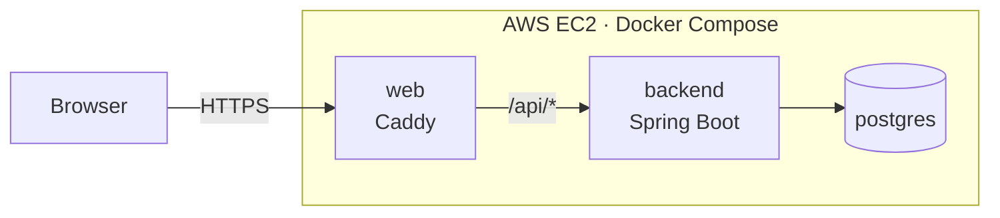

## Deployment

Lime runs at **https://lime.diegomarchesini.com**.

### Architecture

The app runs on an AWS EC2 instance (Ubuntu) with Docker Compose, using three containers:

- **web**: Caddy is the only container exposed to the internet (ports 80 and 443).
  It gets and renews the HTTPS certificate automatically, serves the compiled Angular app,
  and works as a reverse proxy: every request to `/api/*` is forwarded to the backend.
- **backend**: the Spring Boot API. It is not reachable from the internet, only through Caddy.
- **postgres**: the database, with its data stored in a Docker volume. It is not reachable from the internet either.

Since the frontend and the API are served from the same domain, the browser never makes
cross-origin requests, so no CORS configuration is needed in production.

The domain is registered on Cloudflare, where an `A` record points to the instance's Elastic IP.