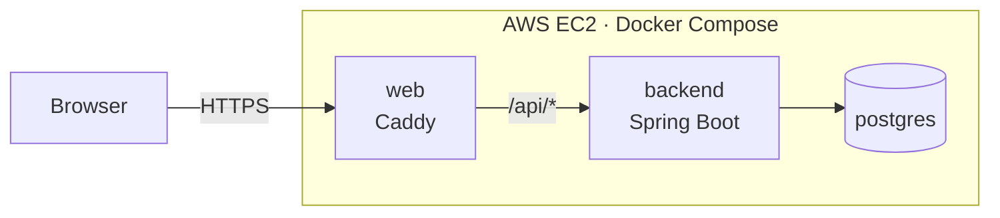

## Deployment

Lime runs at **https://lime.diegomarchesini.com**.

### Architecture

The app runs on an AWS EC2 instance (Ubuntu) with Docker Compose, using three containers:

- **web**: Caddy is the only container exposed to the internet (ports 80 and 443).
  It gets and renews the HTTPS certificate automatically, serves the compiled Angular app,
  and works as a reverse proxy: every request to `/api/*` is forwarded to the backend.
- **backend**: the Spring Boot API. It is not reachable from the internet, only through Caddy.
- **postgres**: the database, with its data stored in a Docker volume. It is not reachable from the internet either.

Since the frontend and the API are served from the same domain, the browser never makes
cross-origin requests, so no CORS configuration is needed in production.

The domain is registered on Cloudflare, where an `A` record points to the instance's Elastic IP.
### Continuous deployment

Every push to `main` goes through GitHub Actions:

1. **build** and **frontend** run in parallel: the backend is built and tested with Gradle,
   and the Angular app is built for production.
2. Only if both succeed, **deploy** connects to the server over SSH.
3. The server pulls the latest code and runs `docker compose up -d --build`:
   Docker rebuilds only the images that changed and restarts only those containers.
   The database data lives in a volume, so it is kept between deploys.

If a test fails, the deploy doesn't run and the previous version stays online.

The SSH key used by GitHub is restricted on the server with a forced command in `authorized_keys`:
it can only run the deploy command, so even a leaked key couldn't be used to open a shell.

### Secrets

No secret is stored in the repository. On the server, the database password, the JWT secret
and the TMDB token live in a `.env` file read by Docker Compose, and the app runs with the
`prod` Spring profile, which has no default values: if a secret is missing, the app refuses to start.